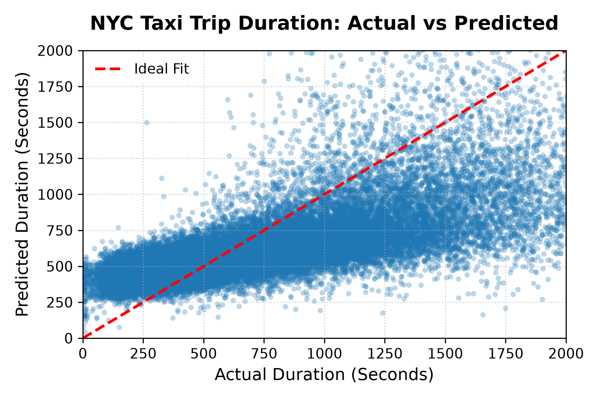

# NYC Taxi Trip Duration Prediction

An end-to-end Machine Learning pipeline that predicts urban taxi trip durations in New York City, built for the [Kaggle NYC Taxi Trip Duration competition](https://www.kaggle.com/competitions/nyc-taxi-trip-duration/). Designed with modular software engineering principles by **[Mahamed Emad](https://www.linkedin.com/in/mahamed-emad/)**, covering data ingestion, automated cleaning, spatial/temporal feature engineering, and custom JSON-based experiment tracking.

> 🏆 **Kaggle Score (RMSLE, lower is better):** Public **0.60477** · Private **0.59897**

---

## 📌 Features

- **Modular Architecture:** Codebase split into reusable Python modules for preprocessing, model training, evaluation, and experiment logging.
- **Data Leakage Prevention:** Built with `scikit-learn` `Pipeline` and `ColumnTransformer` to keep clean boundaries between training and evaluation data.
- **Custom Feature Engineering:**
  - **Spatial Metrics:** Approximated Manhattan/Euclidean distances, trip center coordinates, and grid-based city-block distances derived from raw pickup/dropoff coordinates.
  - **Temporal Extraction:** Hour, day of the week, and month extracted from the pickup datetime.
- **Experiment Tracking:** A lightweight experiment manager that logs hyperparameters and metrics (R², MSE on train/val/test and on the Kaggle data) to `models/experiments.json`, and saves each model as a `.pkl` checkpoint.
- **Target Transformation:** Logarithmic transformation (`log1p` / `expm1`) of the target to handle the skewed duration distribution.
- **Visual Evaluation:** An actual-vs-predicted scatter plot generated from saved predictions (`eda/`).

---

## 📁 Repository Structure

```text
├── data/                  # Train, validation, test, and Kaggle datasets (CSV files)
├── eda/                   # Evaluation & visualization
│   ├── generate_plot.py   # Generates the actual-vs-predicted plot
│   ├── evaluation_plot.png
│   ├── pred.csv           # Saved predictions
│   └── true.csv           # Ground-truth durations
├── models/                # Saved model checkpoints (.pkl) and experiment log (experiments.json)
├── src/                   # Source code modules
│   ├── clean_data.py      # Dataset loading, shuffling, and splitting routines
│   ├── functions.py       # General utilities and metric evaluation
│   ├── model.py           # Pipeline setup and hyperparameter grid search
│   ├── model_config.py    # Experiment tracking and model serialization helpers
│   ├── predict.py         # Prediction logic and evaluation on any split
│   ├── preprocessing.py   # Spatial/temporal transformers and outlier filtering
│   └── train.py           # Training pipeline orchestration
├── main.py                # Entry point to train, evaluate, and create the Kaggle submission
└── README.md
```

---

## ⚙️ Pipeline Overview

1. **Preprocessing:** Remove only extreme duration outliers (trips longer than 350,000 seconds), then extract temporal features from `pickup_datetime`.
2. **Feature Transformation:** Create spatial features, then apply One-Hot Encoding to categorical features and MinMax scaling to numerical ones.
3. **Polynomial Features & Regularization:** Degree-2 polynomial expansion combined with L2-regularized Ridge Regression.
4. **Hyperparameter Tuning:** Grid Search Cross-Validation (`GridSearchCV`, 4 folds, scored by R²) over the regularization strength α.
5. **Evaluation & Logging:** Metrics on train/val/test splits and on the Kaggle data are computed on the log-transformed target and stored in `models/experiments.json`.
6. **Submission:** Predictions for the Kaggle test set are converted back to seconds and saved as a submission file.

---

## 📊 Results & Tracking

Every experiment is saved automatically in `models/experiments.json`. Metrics are computed on the log-transformed target.

| Model Version | Algorithm        | Poly Degree | Alpha (α) | Outlier Bounds (s) | Test R² | Test MSE |
| ------------- | ---------------- | ----------- | --------- | ------------------ | ------- | -------- |
| `model6`      | Ridge Regression | 2           | 0.13      | 300 – 3,600        | 0.342   | 0.416    |
| `model9`      | Ridge Regression | 2           | 0.10      | 300 – 3,600        | 0.345   | 0.414    |
| **`model36`** | Ridge Regression | 2           | 0.10      | 0 – 350,000        | **0.414** | **0.371** |

### Best Model (`model36`)

| Split        | R²    | MSE   |
| ------------ | ----- | ----- |
| Train        | 0.441 | 0.353 |
| Validation   | 0.437 | 0.359 |
| Test         | 0.414 | 0.371 |
| Kaggle Train | 0.438 | 0.356 |

The small gap between train, validation, and test scores shows the model generalizes well for a linear baseline.

### 🏆 Kaggle Leaderboard

| Public Score | Private Score |
| ------------ | ------------- |
| **0.60477**  | **0.59897**   |

The competition metric is RMSLE (lower is better). The private score being slightly better than the public one indicates the model is stable and not overfitted to the public leaderboard.

### 📈 Actual vs. Predicted



The plot compares actual and predicted trip durations (in seconds) for a random sample of 40,000 trips. The red dashed line marks perfect prediction; the closer the points are to it, the better the model.

To regenerate the plot (after running `main.py`):

```bash
python eda/generate_plot.py
```

---

## 🚀 Getting Started

### Prerequisites

Python 3.8+ and the required libraries:

```bash
pip install numpy pandas scikit-learn joblib matplotlib
```

### Data

Download the dataset from the [Kaggle competition page](https://www.kaggle.com/competitions/nyc-taxi-trip-duration/data) and place the files in the `data/` folder:

- `train.csv`, `val.csv`, `test.csv`: local splits used for development (can be generated with `src/clean_data.py`).
- `train_kaggle.csv`, `test_kaggle.csv`: the original Kaggle train and test files.

### Usage

1. Clone the repository:

   ```bash
   git clone https://github.com/Mahamed-Emad/nyc-taxi-trip-duration.git
   cd nyc-taxi-trip-duration
   ```

2. Run the main script to train, evaluate, and generate the Kaggle predictions:

   ```bash
   python main.py
   ```

   This trains the model with grid search, saves the best checkpoint to `models/`, logs all metrics to `models/experiments.json`, and writes the Kaggle submission predictions.

---

## 🔭 Future Improvements

- Try tree-based models (Random Forest, XGBoost, LightGBM) to capture non-linear patterns and improve on the linear baseline.
- Add real road-network features such as the Haversine distance, bearing, and pickup/dropoff clusters.
- Add weather and holiday features.
- Add unit tests and a command-line interface for training configuration.

---

## 🔗 Author

**Mahamed Emad**

- GitHub: [Mahamed-Emad](https://github.com/Mahamed-Emad)
- LinkedIn: [mahamed-emad](https://www.linkedin.com/in/mahamed-emad/)

---

## 📜 License

Distributed under the MIT License.
